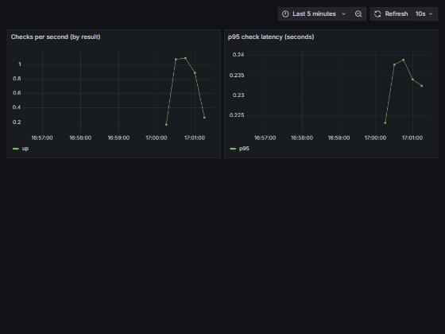

# Uptime Monitor — a cloud-native microservice

A small but production-shaped service that monitors whether websites are up. It is
built the way a real service is run: containerized, observable, tested, security-scanned,
and deployable to AWS with Infrastructure as Code.

I built this to practice the core skills shared across **DevOps, Site Reliability,
Cloud/AWS, and Cybersecurity** roles. It was built with AI assistance and I went through
every check myself. The full step-by-step record, including what broke and what I fixed, is in
[docs/BUILD-LOG.md](docs/BUILD-LOG.md).



---

## What it does

Register URLs, check whether they respond, and watch the results on a live dashboard.
The service exposes the same health and metrics endpoints a real production service
would, so an orchestrator (Kubernetes, ECS) can manage it and Prometheus can monitor it.

| Endpoint | Purpose |
|---|---|
| `POST /targets` | Register a URL to monitor (validated input) |
| `GET /targets` | List registered targets |
| `DELETE /targets/{name}` | Remove a target |
| `POST /check/{name}` | Check a target now, record metrics |
| `GET /healthz` | Liveness probe — is the process alive? |
| `GET /readyz` | Readiness probe — is it ready for traffic? |
| `GET /metrics` | Prometheus metrics (SLIs) |

---

## What it achieves

- **A working observability loop:** the app exposes metrics, Prometheus collects them, and Grafana
  charts checks per second and p95 latency, all started with one command.
- **Production-style health probes:** separate liveness (`/healthz`) and readiness (`/readyz`)
  endpoints, the way Kubernetes and ECS expect.
- **A hardened container:** multi-stage build, non-root user, built-in health check, no pip in
  the final image, and a Trivy scan with no fixable findings.
- **An automated quality gate:** lint, source security scan, tests, then image build and scan, on
  every push.
- **Infrastructure as code for AWS:** Terraform for ECR, ECS Fargate, IAM and logs (written, not
  applied by me; see Known limitations).

## How it was built

Step by step, with the commands, the screenshots and the problems I hit, in
[docs/BUILD-LOG.md](docs/BUILD-LOG.md).

## Architecture

```
                 ┌─────────────┐      scrapes /metrics      ┌────────────┐
   HTTP  ───────▶│  FastAPI    │◀───────────────────────────│ Prometheus │
                 │  app        │                            └─────┬──────┘
                 │ (container) │                                  │ queries
                 └─────────────┘                            ┌─────▼──────┐
                                                            │  Grafana   │
                                                            │ dashboard  │
                                                            └────────────┘
```

Everything runs locally with one command via Docker Compose. The same container
image deploys to **AWS Fargate** using the Terraform in `terraform/`.

---

## Skills this project demonstrates

- **Cloud / AWS** — Terraform provisions ECR, ECS/Fargate, CloudWatch logs, IAM
  (least-privilege), and a security group.
- **DevOps** — multi-stage Docker build, Docker Compose stack, GitHub Actions CI/CD
  (lint → test → security scan → build).
- **SRE / Observability** — liveness/readiness probes, Prometheus metrics as SLIs,
  a Grafana dashboard (checks/sec and p95 latency), structured JSON logs.
- **Cybersecurity** — input validation at the boundary (Pydantic), non-root hardened
  container, image CVE scanning (Trivy), source scanning (Bandit), secrets via env vars,
  ECR scan-on-push.

---

## Run it locally

### Option A — just the app (needs Python 3.11+)

```bash
pip install -r requirements-dev.txt
make run          # or: uvicorn app.main:app --reload
```

Open http://localhost:8000/docs for the interactive API, and try:

```bash
curl -X POST localhost:8000/targets -H "Content-Type: application/json" \
  -d '{"name": "example", "url": "https://example.com"}'
curl -X POST localhost:8000/check/example
```

### Option B — the full observability stack (needs Docker)

```bash
make up            # or: docker compose up --build
```

- App:        http://localhost:8000/docs
- Prometheus: http://localhost:9090
- Grafana:    http://localhost:3000  (login `admin` / `admin`, dashboard "Uptime Monitor").
  This default login is for running locally only. Change it before exposing Grafana anywhere.

---

## Run the tests and checks

```bash
make test          # pytest
make lint          # ruff
make security      # bandit source scan
```

The same steps run automatically in CI on every push (`.github/workflows/ci.yml`).

---

## Deploy to AWS (optional)

> Requires an AWS account and the AWS CLI configured. Most resources are free-tier
> eligible, but **you are responsible for any charges** — run `terraform destroy`
> when done.

```bash
cd terraform
terraform init
terraform plan      # review what will be created
terraform apply
```

Then build, tag, and push the image to the ECR URL from the Terraform output, and
the Fargate service will run it. See [docs/DEPLOY.md](docs/DEPLOY.md) for the full walkthrough.

---

## Project layout

```
app/                 FastAPI application (config, logging, models, monitor, main)
tests/               pytest unit + API tests
terraform/           AWS infrastructure as code (ECR, ECS/Fargate, IAM, logs)
monitoring/          Prometheus config + Grafana dashboards
.github/workflows/   CI pipeline
Dockerfile           Multi-stage, non-root, with healthcheck
docker-compose.yml   Full local stack
```

## Known limitations

- The Terraform is written but not applied to a real AWS account by me.
- A Trivy scan of the image shows 44 HIGH findings in Debian base packages that have no patch
  available yet. CI fails on anything that does have a fix. Details in the build log.
- Targets are held in memory, so they reset when the container restarts.

## What I'd add next

- Persistent storage (Postgres) instead of in-memory targets
- Scheduled background checks with alerting rules in Prometheus
- An Application Load Balancer + HTTPS in front of the Fargate service
